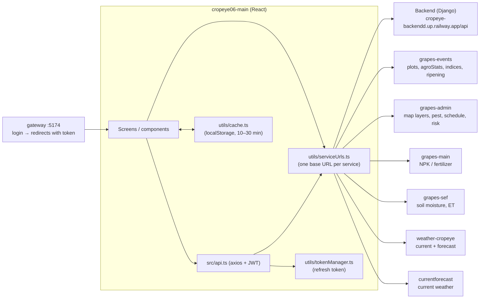

# CropEye Grapes — API Architecture & Endpoint Map

App: `cropeye06-main` (Vite, port 3001, Render base `/grapes/`). Login gateway: `gateway` (port 5174).
Status checked live against Railway on 12 Oct 2026. Without a token, **401/405 = route exists**, **404 = missing**.

Legend: ✅ working · ⚠️ works but has an issue · ❌ broken / missing

---

## 1. Architecture

### How base URLs are chosen (`src/utils/serviceUrls.ts`)

| Service | Function | Railway URL | Prod proxy path (nginx) |
|---|---|---|---|
| Backend | `getBackendApiBaseUrl()` | `https://cropeye-backendd.up.railway.app/api` | `/api/backend` |
| Events | `getEventsBaseUrl()` | `https://cropeye-grapes-events-production.up.railway.app` | `/api/events` |
| Admin | `getGrapesAdminBaseUrl()` | `https://cropeye-grapes-admin-production.up.railway.app` | `/api/dev-plot` |
| Main (NPK) | `getGrapesMainBaseUrl()` | `https://cropeye-grapes-main-production.up.railway.app` | `/api/grapes-main` |
| SEF | `getGrapesSefBaseUrl()` | `https://cropeye-grapes-sef-production.up.railway.app` | `/api/field-analysis` |
| Weather | `getWeatherBaseUrl()` | `https://weather-cropeye.up.railway.app` | `/api/weather` |
| Forecast | `getForecastWeatherBaseUrl()` | `https://currentforecast-production.up.railway.app` | `/api/forecast-weather` |

- **Local dev:** calls Railway directly (visible in the Network tab). Set `VITE_USE_API_PROXY=true` to use the Vite `/api/*` proxies instead.
- **Production build:** uses the same-origin proxy paths above.
- Each service can be overridden with `VITE_*_BASE_URL` in `.env`. Localhost overrides are ignored in production builds.

---

## 2. Backend (Django) — `cropeye-backendd.up.railway.app/api`

All calls go through `src/api.ts` (axios instance with `Authorization: Bearer <token>`).

### Auth & users

| Endpoint | Method | Function (api.ts) | Used in | Status |
|---|---|---|---|---|
| `/login/` | POST | `gatewayAuth.ts` | Login (gateway) | ✅ |
| `/token/refresh/` | POST | `tokenManager.ts` | Every screen (auto refresh) | ✅ |
| `/users/me/` | GET | `getCurrentUser` | App start, profile, industry detection | ✅ |
| `/users/` | GET/POST | `getUsers`, `addUser` | User list, Add user, Manager home count | ✅ |
| `/users/{id}/` | PATCH | `updateUser` | Edit user | ✅ |
| `/users/total-count/` | GET | `getTotalCounts` | Manager home (`DashboardNo`) | ✅ || `/users/contact-details/` | GET | `getContactDetails` | Contact Users | ✅ |

### Owner / team hierarchy

| Endpoint | Method | Function | Used in | Status |
|---|---|---|---|---|
| `/users/owner-hierarchy/` | GET | `loadOwnerFieldOfficers` | Owner home (unit cards + unit view), Farm Crop Status, Harvest Planning | ✅ |
| `/users/owner-hierarchy/?manager_id=` | GET | manager drill-down | OwnerFarmDash (manager select) | ✅ |
| `/users/grapes/plots/?industry_id=` | GET | `getGrapesIndustryPlots` → merged by `mergeIndustryPlotsIntoHierarchy` | Owner home, Farm Crop Status, Harvest (plots with no FO become "Unassigned") | ✅ |
| `/users/owner-team-connect/?industry_id=` | GET | `getOwnerTeamConnect` | Team Connect, Harvest Planning | ✅ |
| `/users/team-connect/` | GET | team connect | Team Connect | ✅ |
| `/users/my-field-officers/` | GET | `getMyFieldOfficers` | Manager screens, Harvest fallback | ✅ |
| `/users/farmers-by-field-officer/?field_officer_id=` | GET | query form (route exists) | — | ✅ |
| `/users/farmers-by-field-officer/{id}/` | GET | `getFarmersByFieldOfficerId` (api.ts:335), `grapesOwnerHierarchy.ts:154` | FO drill-down | ❌ 404 → switch to query form |
| `/users/owner-hierarchy/grapes/` | GET | `api/grapesOwnerHierarchy.ts:111,124` | Grapes Hierarchy page | ❌ 404 (falls back to `/users/owner-hierarchy/`) |
| `/users/team-connect/grapes/` | GET | `getTeamConnectGrapes` (api.ts:1700) | HarvestDashboard, OwnerHarvestDash | ❌ 404 (falls back; wasted call) |

### Farms, plots, farmers

| Endpoint | Method | Function | Used in | Status |
|---|---|---|---|---|
| `/farms/` (+ `?include_farmer=true`, `?farmer_id=`) | GET/POST | `getFarms`, `createFarm` | Farm list, Add Farm, Farmer dashboard | ✅ |
| `/farms/{id}/` | GET/PUT/PATCH/DELETE | farm CRUD | Edit farm | ✅ |
| `/farms/my-profile/` | GET | `getFarmerMyProfile` | Farmer dashboard (skipped for owner/admin) | ✅ |
| `/farms/my-farmers/`, `/farms/recent-farmers/` | GET | `getFarmersByFieldOfficer` + FO lists | Field officer home | ✅ |
| `/farms/geojson/` | GET | `getFarmsGeoJSON` | Maps | ✅ |
| `/farms/register-farmer/grapes/` | POST | `registerFarmerAllInOne` | Add Farm (grapes) | ✅ |
| `/plots/{id}/` | PATCH | `patchPlot` | Edit plot | ✅ |
| `/soil-types/`, `/crop-types/` | GET | lookups | Add Farm | ✅ |
| `/farm-plots/`, `/farm-plots/geojson/` | GET/POST | api.ts:1563–1576 | Legacy map code | ❌ 404 (backend never built) |
| `/new-plantation/` | POST | `createNewPlantation` (api.ts:284) | Legacy form | ❌ 404 |
| `/irrigations/{id}/` | PATCH | api.ts:1529 | Legacy irrigation edit | ❌ 404 |

### Operations, messaging, reports

| Endpoint | Method | Used in | Status |
|---|---|---|---|
| `/tasks/` (+ `/{id}/`, `?assigned_to_id=`) | GET/POST/PUT/PATCH | Tasks, Calendar | ✅ |
| `/vendors/`, `/orders/`, `/stock/`, `/bookings/` | CRUD | Inventory screens | ✅ |
| `/messages/`, `/conversations/…` | GET/POST | Chat | ✅ |
| `/soil-reports/`, `/grapse-reports/` | GET/POST/PATCH | Soil analysis, report upload | ✅ |
| `/notifications/`, `/notifications/mark-all-read/` | GET/PATCH | `FarmerInfoBar.tsx:697,727` | ⚠️ code builds `/api/api/notifications/` → 404. Remove the extra `/api` |
| `ws://…/ws/notifications/?token=` | WebSocket | `FarmerInfoBar.tsx:820` | ✅ (base strips `/api`) |

---

## 3. Grapes Events — `cropeye-grapes-events-production`

| Endpoint | Method | Used in (file) | Purpose | Status |
|---|---|---|---|---|
| `/plots/agroStats?end_date=` | GET | `useOwnerPortfolio.ts`, `grapesEventsBundle.ts`, `Map.tsx`, `HarvestDashboard`, `OwnerHarvestDash`, `harvestStatusService.ts` | Yield, Brix, soil pH/OC, area, harvest status for **all** plots (one batch) | ✅ (current_growth_stage is empty for grapes rows) |
| `/plots/{plot}/indices` | GET | `useOwnerPlotInsights.ts`, `FarmCropStatus`, `FarmerDashboard`, `dataPreloader` | NDVI / NDMI / NDWI / NDRE history | ✅ |
| `/plots/{plot}/stress?index_type=NDRE&threshold=0.15` | GET | `OwnerFarmDash`, `FarmCropStatus`, `ManagerFarmDash`, `FarmerDashboard` | Stress events | ✅ |
| `/plots/{plot}/irrigation?…` | GET | `IrrigationSchedule`, `FarmCropStatus`, `FarmerDashboard` | Irrigation events | ✅ |
| `/plots/{plot}/rvi`, `/biomass`, `/harvest-analysis` | GET | available, lightly used | Biomass / harvest analysis | ✅ |
| `/analyze?plot_name=&end_date=&days_back=7` | GET | `OwnerFarmDash`, `FarmCropStatus`, `ManagerFarmDash`, `grapesEventsBundle` | Field health summary | ✅ |
| `/grapes/ripening-stage` | POST | `utils/ripeningMilestones.ts` → OwnerFarmDash **Crop Status card** | Ripening start, harvest-ready date, crop stage | ✅ |
| `/grapes/yield-estimation` | POST | `grapesEventsBundle.ts` | Yield estimate | ⚠️ sometimes 500 (handled with allSettled) |
| `/grapes/brix-time-series` | POST | `FarmerDashboard`, `dataPreloader` | Brix trend | ✅ |
| `/harvest/growth-stages` | GET | not used | Growth stages | ⚠️ returns **sugarcane** stages — not usable for grapes |
| `/plots/analyzeSinglePlot?plot_id=` | GET | `getSinglePlotAgroStats` (api.ts:1716) | Single-plot analysis | ❌ route does not exist → use `/analyze` or `/plots/{p}/indices` |

## 4. Grapes Admin — `cropeye-grapes-admin-production`

| Endpoint | Method | Used in | Purpose | Status |
|---|---|---|---|---|
| `/image-dates?plot_name=` | GET | `Map.tsx`, `analysisTimeline.ts` | Satellite image dates | ✅ |
| `/analyze_Growth` | POST | `Map.tsx`, `dataPreloader` | Growth layer + plot boundary | ✅ |
| `/wateruptake` | POST | `Map.tsx`, `WaterUptakeCard`, `dataPreloader` | Water uptake layer | ✅ |
| `/SoilMoisture` | POST | `Map.tsx`, `dataPreloader` | Soil moisture map layer | ✅ |
| `/pest-detection` | POST | `Map.tsx`, `dataPreloader` | Pest layer | ✅ |
| `/grapes/canopy-vigour1` | POST | `Map.tsx`, `OwnerFarmDash`, `FarmCropStatus`, `ManagerFarmDash`, `FarmerDashboard` | Canopy vigour | ✅ |
| `/grapes/brix-grid-values` | POST | `Map.tsx`, `dataPreloader` | Brix grid layer | ✅ |
| `/grapes-schedule/{plot}` | GET | `FertilizerTable`, `Header`, `grapesSchedule.ts`, `riskAssessmentService` | Grape schedule / growth day | ✅ |
| `/risk-assessment?plot_name=` | GET | `riskAssessmentService.ts`, `useOwnerPlotInsights`, `dataPreloader` | Pest / disease / weed risk | ✅ |

## 5. Grapes Main (NPK) — `cropeye-grapes-main-production`

| Endpoint | Method | Used in | Status |
|---|---|---|---|
| `/required-n/{plot}` | POST | `useNpkData.ts`, `SoilAnalysis.tsx`, `dataPreloader` | ✅ |
| `/analyze-npk/{plot}` | POST | `SoilAnalysis.tsx`, `dataPreloader` | ✅ |

## 6. Grapes SEF — `cropeye-grapes-sef-production`

| Endpoint | Method | Used in | Status |
|---|---|---|---|
| `/soil-moisture/{plot_name}` | **POST** | `SoilMoistureTrendCard.tsx`, `dataPreloader.ts` | ✅ (200, 5-day stack) |
| `/soil-moisture/{plot}` via **GET** and `/irrigation-and-soil-moisture/{plot}` | GET | `utils/soilMoistureApi.ts:188–189` (SoilMoistureCard, owner soil moisture) | ❌ 405 / 404 → change to POST `/soil-moisture/{plot_name}` |
| `/soil-moisture` (no plot in path) | POST | `soilMoistureApi.ts:241` | ❌ wrong path |
| `/plots/{plot}/compute-et/` | POST | `EvapotranspirationCard.tsx` | ✅ |
| `/water-remain-per-day` | GET | `utils/waterRemainApi.ts` | ⚠️ not on grapes SEF; code falls back to the **sugarcane** SEF (`sef-cropeye`) |

## 7. Weather

| Endpoint | Used in | Status |
|---|---|---|
| `weather-cropeye /current-weather?lat=&lon=` | `weatherService.ts`, `IrrigationSchedule`, owner Agroclimate | ✅ |
| `weather-cropeye /forecast?lat=&lon=` | `weatherForecastService.ts`, `IrrigationSchedule`, owner Agroclimate | ✅ |
| `currentforecast /current-weather` | `weatherService.ts` (primary) | ✅ |
| `api.open-meteo.com /v1/forecast` | `IrrigationSchedule`, `SoilMoistureCard` (rain/ET fallback) | ✅ (public API) |

---

## 8. Screen → endpoint map (owner)

| Screen | Endpoints |
|---|---|
| **Owner home — unit cards** (`OwnerUnitLanding`) | `/users/owner-hierarchy/` + `/users/grapes/plots/?industry_id=` → `/plots/agroStats` |
| **Owner home — unit view** (`OwnerIntelligenceDashboard`) | same as above + `/plots/{p}/indices`, POST `/soil-moisture/{p}`, `/risk-assessment`, weather `/current-weather` + `/forecast` |
| **Farm Crop Status** (`OwnerFarmDash`) | hierarchy + `/plots/agroStats`, `/analyze`, `/plots/{p}/stress`, `/grapes/canopy-vigour1`, POST `/grapes/ripening-stage` (Crop Status card) |
| **Harvest Planning** (`OwnerHarvestDash`) | `/users/owner-team-connect/`, (`/users/team-connect/grapes/` ❌ fallback), `/plots/agroStats` |
| **Agroclimatic** | weather `/current-weather`, `/forecast` |
| **Team Connect** | `/users/owner-team-connect/`, `/users/team-connect/` |
| **Contact Users** | `/users/contact-details/` |
| **Map layers** (`Map.tsx`) | admin `/analyze_Growth`, `/wateruptake`, `/SoilMoisture`, `/pest-detection`, `/grapes/canopy-vigour1`, `/grapes/brix-grid-values`, `/image-dates`, events `/plots/agroStats` |

---

## 9. Issue list & fixes

| # | Issue | Where | Fix | Owner |
|---|---|---|---|---|
| 1 | Soil moisture uses GET / wrong path | `utils/soilMoistureApi.ts:188,189,241` | Use **POST `/soil-moisture/{plot_name}`** | Frontend |
| 2 | Notifications URL has `/api/api/` | `FarmerInfoBar.tsx:697,727` | Drop the extra `/api` | Frontend |
| 3 | `/plots/analyzeSinglePlot` missing | `api.ts:1716` | Use `/analyze` or `/plots/{p}/indices` | Frontend |
| 4 | FO farmers path form 404 | `api.ts:335`, `grapesOwnerHierarchy.ts:154` | Use `?field_officer_id={id}` | Frontend |
| 5 | `owner-hierarchy/grapes/`, `team-connect/grapes/` 404 | `grapesOwnerHierarchy.ts`, `api.ts:1700`, Harvest screens | Remove calls (fallbacks already work) or build them | Frontend / Backend |
| 6 | `farm-plots/`, `new-plantation/`, `irrigations/{id}/` 404 | `api.ts:284,1529,1563–1576` | Build them or delete the dead code | Backend / Frontend |
| 7 | No grape growth stage per plot | `agroStats.current_growth_stage` empty; `/harvest/growth-stages` returns sugarcane | Fill stage for grapes rows, or add `GET /grapes/stages/` | Backend |
| 8 | Varieties hardcoded | `Add Farm.tsx`, `utils/grapesVarieties.ts`, `utils/grapeVarieties.ts` | Add `GET /grapes/varieties/` and store variety on each plot | Backend |
| 9 | Water balance uses sugarcane service | `utils/waterRemainApi.ts` | Add `/water-remain-per-day` to grapes SEF | Backend |
| 10 | Yield estimation occasional 500 | events `/grapes/yield-estimation` | Investigate server errors | Backend |

## 10. Caching

| Data | Key | TTL |
|---|---|---|
| Owner hierarchy | `ownerPortfolio_hierarchy_v2` | 10 min |
| agroStats batch | `agroStats_{YYYY-MM-DD}` | 10 min |
| Map layers / plot data | `{dataType}_{plotName}_{endDate}` | 30 min |
| Missing-route flags | `teamConnectGrapesMissing:<backend>`, `grapesIndustryPlotsMissing:<backend>` | browser session |
