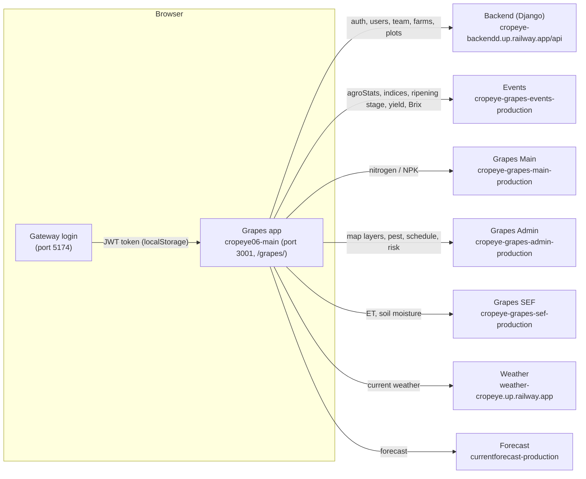
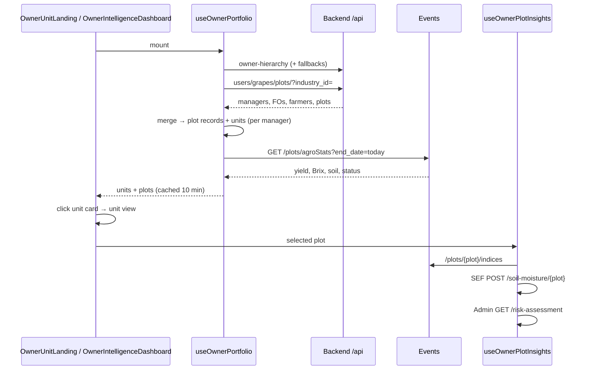

# CropEye Grapes (cropeye06-main) — API Architecture

Status checked live on 12 Oct 2026 against the Railway services.
Legend: ✅ working · ⚠️ works but needs cleanup · ❌ broken / missing

---

## 1. System overview

### How base URLs are chosen — `src/utils/serviceUrls.ts`

| Function | Local dev (`npm run dev`) | Production build (Render) |
|---|---|---|
| `getBackendApiBaseUrl()` | `https://cropeye-backendd.up.railway.app/api` | `VITE_API_BASE_URL` or `/api/backend` (nginx) |
| `getEventsBaseUrl()` | `https://cropeye-grapes-events-production.up.railway.app` | `/api/events` |
| `getGrapesMainBaseUrl()` | `https://cropeye-grapes-main-production.up.railway.app` | `/api/grapes-main` |
| `getGrapesAdminBaseUrl()` | `https://cropeye-grapes-admin-production.up.railway.app` | `/api/dev-plot` |
| `getGrapesSefBaseUrl()` | `https://cropeye-grapes-sef-production.up.railway.app` | `/api/field-analysis` |
| `getWeatherBaseUrl()` | `https://weather-cropeye.up.railway.app` | `/api/weather` |
| `getForecastWeatherBaseUrl()` | `https://currentforecast-production.up.railway.app` | `/api/forecast-weather` |

Set `VITE_USE_API_PROXY=true` in `.env` to make dev use the Vite `/api/*` proxies instead of direct URLs.

**Rule:** every request must build its URL from one of these functions. Never hardcode a Railway URL in a component.

---

## 2. Screen → endpoint map

### 2.1 Login & session
| Endpoint | Method | Called from | Status |
|---|---|---|---|
| `/api/login/` | POST | gateway login | ✅ |
| `/api/token/refresh/` | POST | `utils/tokenManager.ts` | ✅ |
| `/api/users/me/` | GET | `hooks/useFarmerProfile.ts`, `utils/userIndustry.ts` (saves industry) | ✅ |

### 2.2 Owner home (landing → unit view)
Files: `components/ownerDashboard/OwnerUnitLanding.tsx`, `OwnerIntelligenceDashboard.tsx`, hooks `useOwnerPortfolio.ts`, `useOwnerPlotInsights.ts`

| Endpoint | Method | Called from | Used for | Status |
|---|---|---|---|---|
| `/api/users/owner-hierarchy/` | GET | `api.ts → loadOwnerHierarchyBase` | managers → FOs → farmers → plots | ✅ |
| `/api/users/owner-team-connect/` | GET | `api.ts` (fallback) | same tree, other shape | ✅ |
| `/api/users/my-field-officers/` | GET | `api.ts` (fallback) | FO list | ✅ |
| `/api/users/farmers-by-field-officer/?field_officer_id=` | GET | `api.ts` (fallback) | farmers per FO | ✅ |
| `/api/users/grapes/plots/?industry_id=` | GET | `api.ts → getGrapesIndustryPlots` (merged in `loadOwnerFieldOfficers`) | all industry plots, incl. plots with no FO | ✅ |
| `/plots/agroStats?end_date=` | GET | `useOwnerPortfolio.ts` | yield, Brix, soil, status per plot | ✅ |
| `/plots/{plot}/indices` | GET | `useOwnerPlotInsights.ts` | NDVI / NDMI / NDRE trend | ✅ |
| `/soil-moisture/{plot}` (SEF) | POST | `useOwnerPlotInsights.ts` | soil moisture card | ✅ |
| `/risk-assessment?plot_name=` (Admin) | GET | `useOwnerPlotInsights.ts` | pest / disease / weed risk | ✅ |
| `/current-weather`, `/forecast` | GET | `ownerDashboard/OwnerAgroclimate.tsx` | agroclimate section | ✅ |

### 2.3 Farm Crop Status (owner / manager)
Files: `OwnerFarmDash.tsx`, `ManagerFarmDash.tsx`, `FarmCropStatus.tsx`

| Endpoint | Method | Called from | Status |
|---|---|---|---|
| Owner hierarchy (same as 2.2) | GET | `OwnerFarmDash.tsx` | ✅ |
| `/plots/agroStats` | GET | `utils/grapesEventsBundle.ts`, `FarmCropStatus.tsx:686` | ⚠️ `FarmCropStatus.tsx` hardcodes the Railway URL |
| `/grapes/ripening-stage` | POST | `utils/ripeningMilestones.ts` | ✅ (Crop Status stage card) |
| `/grapes/yield-estimation`, `/grapes/brix-time-series` | POST | `utils/grapesEventsBundle.ts` | ✅ |
| `/analyze-npk/{plot}` (Main) | POST | `utils/grapesEventsBundle.ts` | ✅ (soil fallback) |
| `/grapes/canopy-vigour1` (Admin) | POST | `OwnerFarmDash.tsx:1368`, `ManagerFarmDash.tsx:1018`, `FarmCropStatus.tsx:1308` | ✅ |

### 2.4 Harvest Planning
Files: `OwnerHarvestDash.tsx`, `HarvestDashboard.tsx`, `utils/harvestStatusService.ts`

| Endpoint | Method | Called from | Status |
|---|---|---|---|
| `/api/users/team-connect/grapes/` | GET | `api.ts:1700`, `HarvestDashboard.tsx:726`, `OwnerHarvestDash.tsx:928` | ❌ 404, falls back to `my-field-officers` |
| `/api/users/team-connect/` | GET | fallback | ✅ |
| `/plots/agroStats` | GET | `OwnerHarvestDash.tsx:1065`, `HarvestDashboard.tsx:962`, `harvestStatusService.ts:77` | ✅ |
| `/grapes/ripening-stage` | POST | `harvestStatusService.ts` | ✅ |

### 2.5 Map (farmer / FO)
File: `components/Map.tsx`, preloading in `services/dataPreloader.ts`

| Endpoint | Method | Service | Status |
|---|---|---|---|
| `/image-dates?plot_name=` | GET | Admin | ✅ |
| `/analyze_Growth` | POST | Admin | ✅ |
| `/wateruptake` | POST | Admin | ✅ |
| `/SoilMoisture` | POST | Admin | ✅ |
| `/pest-detection` | POST | Admin | ✅ |
| `/grapes/canopy-vigour1` | POST | Admin | ✅ |
| `/grapes/brix-grid-values` | POST | Admin | ✅ |
| `/plots/agroStats` | GET | Events | ✅ |

### 2.6 Irrigation & soil moisture
Files: `components/Irrigation/*`, `hooks/useIrrigationSchedule.ts`, `utils/soilMoistureApi.ts`

| Endpoint | Method | Called from | Status |
|---|---|---|---|
| `/plots/{plot}/compute-et/` (SEF) | POST | `useIrrigationSchedule.ts:389`, `EvapotranspirationCard.tsx:101` | ✅ |
| `/soil-moisture/{plot}` (SEF) | POST | `SoilMoistureTrendCard.tsx:268`, `dataPreloader.ts:579` | ✅ |
| `/irrigation-and-soil-moisture/{plot}` (SEF) | GET | `soilMoistureApi.ts:188` | ❌ does not exist |
| `/soil-moisture/{plot}` (SEF) | **GET** | `soilMoistureApi.ts:189` | ❌ 405, route only accepts POST |
| `/soil-moisture` (no plot in path) | POST | `soilMoistureApi.ts:241` | ❌ wrong path |
| `/wateruptake` on **SEF** | POST | `dataPreloader.ts:618` | ❌ SEF has no `/wateruptake` (Admin does) |
| `/wateruptake` (Admin) | POST | `WaterUptakeCard.tsx:54` | ✅ |
| `/current-weather` | GET | `IrrigationSchedule.tsx:296` | ⚠️ hardcoded URL |

### 2.7 Fertilizer & soil
Files: `Fertilizer.tsx`, `SoilAnalysis.tsx`, `hooks/useNpkData.ts`, `FertilizerTable.tsx`

| Endpoint | Method | Service | Status |
|---|---|---|---|
| `/required-n/{plot}` | POST | Main | ✅ |
| `/analyze-npk/{plot}` | POST | Main | ✅ |
| `/grapes-schedule/{plot}` | GET | Admin (`grapesSchedule.ts`, `Header.tsx`, `FertilizerTable.tsx`) | ✅ |

### 2.8 Pest & disease
| Endpoint | Method | Called from | Status |
|---|---|---|---|
| `/risk-assessment?plot_name=` (Admin) | GET | `pestt/meter/riskAssessmentService.ts:123` | ✅ |
| `/pest-detection` (Admin) | POST | `riskAssessmentService.ts:441` | ✅ |

### 2.9 Farmer, FO, admin pages
| Endpoint | Method | Called from | Status |
|---|---|---|---|
| `/api/farms/`, `/api/my-profile/`, `/api/my-farmers/`, `/api/recent-farmers/` | GET | `api.ts` | ✅ |
| `/api/register-farmer/grapes/` | POST | `Add Farm.tsx` | ✅ |
| `/api/plots/`, `/api/soil-types/`, `/api/crop-types/`, `/api/farms/geojson/` | GET | `api.ts` | ✅ |
| `/api/tasks/`, `/api/vendors/`, `/api/orders/`, `/api/stock/`, `/api/bookings/` | GET/POST | `api.ts` | ✅ |
| `/api/messages/`, `/api/conversations/` | GET/POST | `api.ts` | ✅ |
| `/api/soil-reports/`, `/api/grapse-reports/` | GET | `api.ts` | ✅ |
| `/api/users/farmers-by-field-officer/{id}/` (id in path) | GET | `api.ts:335`, `api/grapesOwnerHierarchy.ts:154` | ❌ 404; use `?field_officer_id={id}` |
| `/api/users/owner-hierarchy/grapes/` | GET | `api/grapesOwnerHierarchy.ts:111,124` | ❌ 404 |
| `/api/new-plantation/` | POST | `api.ts:284` | ❌ 404 |
| `/api/irrigations/{id}/` | PATCH | `api.ts:1529` | ❌ 404 |
| `/api/farm-plots/`, `/api/farm-plots/geojson/` | GET/POST | `api.ts:1563-1576` | ❌ 404 |
| `/plots/analyzeSinglePlot` (Events) | GET | `api.ts:1716` | ❌ not in Events API |

### 2.10 Notifications
| Endpoint | Called from | Status |
|---|---|---|
| `/api/notifications/`, `/api/notifications/mark-all-read/` | `FarmerInfoBar.tsx:697,727` | ❌ URL becomes `/api/api/notifications/` (404) |
| `wss://…/ws/notifications/?token=` | `FarmerInfoBar.tsx:820` | ✅ (trailing `/api` already stripped) |

---

## 3. Issues & fixes (to-do list)

### Frontend fixes (can be done now)
| # | Problem | File | Fix |
|---|---|---|---|
| F1 | Soil moisture uses GET / wrong paths | `utils/soilMoistureApi.ts` | Call `POST /soil-moisture/{plot_name}` on SEF only |
| F2 | Double `/api` in notifications | `FarmerInfoBar.tsx:697,727` | Use `${base}/notifications/` (base already ends with `/api`) |
| F3 | `analyzeSinglePlot` missing | `api.ts:1716` | Use `/plots/{plot}/indices` or `POST /analyze` |
| F4 | FO farmers path form 404 | `api.ts:335`, `api/grapesOwnerHierarchy.ts:154` | Use `?field_officer_id={id}` |
| F5 | Calls to `owner-hierarchy/grapes` and `team-connect/grapes` always 404 | `api/grapesOwnerHierarchy.ts`, `api.ts:1700`, `HarvestDashboard.tsx`, `OwnerHarvestDash.tsx` | Remove and call the working routes directly (or keep until backend ships them) |
| F6 | `/wateruptake` sent to SEF | `services/dataPreloader.ts:618` | Use `getGrapesAdminBaseUrl()` |
| F7 | Hardcoded Railway URLs (bypass `serviceUrls.ts`) | `AgroDashboard.tsx:234`, `FarmCropStatus.tsx:686`, `IrrigationSchedule.tsx:296`, `EvapotranspirationCard.tsx:225`, `dataPreloader.ts:551,579,618,734` | Replace with `getEventsBaseUrl()`, `getWeatherBaseUrl()`, `getGrapesSefBaseUrl()`, `getGrapesAdminBaseUrl()` |
| F8 | Hidden default `plantation_date=2025-01-01` | `services/dataPreloader.ts:488` | Skip the request when the plot has no plantation date |
| F9 | Old doc has broken URLs | `API_ENDPOINTS_SUMMARY.md` | Replace with this file |

### Backend work needed
| # | Need | Why |
|---|---|---|
| B1 | Fill `current_growth_stage` in `/plots/agroStats` for grapes rows (empty today) | Stage per plot on owner dashboard without calling `ripening-stage` one plot at a time |
| B2 | Grapes stages for `/harvest/growth-stages` | Currently returns **sugarcane** stages (Germination, Tillering, Grand Growth) |
| B3 | `GET /api/grapes/varieties/` + variety stored on each plot | Variety list is hardcoded in `Add Farm.tsx`; needed for variety-by-district views |
| B4 | Build or drop: `owner-hierarchy/grapes`, `team-connect/grapes`, `farm-plots`, `new-plantation`, `irrigations/{id}` | Frontend calls them; they return 404 |

---

## 4. Data flow — owner dashboard

## 5. Caching
- Helpers: `getCache` / `setCache` in `src/utils/cache.ts`, default lifetime 10 minutes.
- Owner hierarchy: key `ownerPortfolio_hierarchy_v2`.
- agroStats: key `agroStats_{YYYY-MM-DD}`.
- Missing-route flags (sessionStorage): `teamConnectGrapesMissing:<backend>` and `grapesIndustryPlotsMissing:<backend>`. Once a route returns 404, the app stops calling it for the rest of the session.
